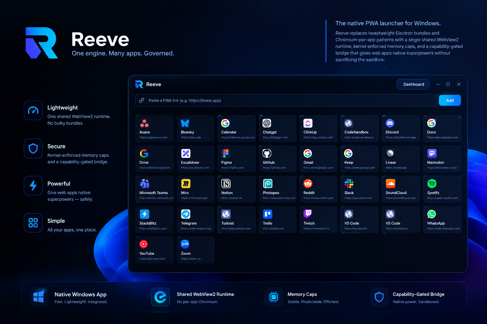

# Reeve

**One engine. Many apps. Governed.**




Reeve is a native PWA launcher for Windows. It replaces heavyweight Electron bundles and Chromium-per-app patterns with a single shared WebView2 runtime, kernel-enforced memory caps, per-app data isolation, and a capability-gated bridge that gives web apps native superpowers without sacrificing the sandbox.

---

## The Problem

Every Electron app ships its own Chromium. Open five apps, and you are running five browser process trees. The RAM cost is enormous, startup is slow, and none of those bundled browsers can share a renderer or GPU process with each other.

```

Electron model:              Reeve model:
┌──────────┐                 ┌──────────┐ ┌──────────┐ ┌──────────┐
│ Chromium │                 │ Renderer │ │ Renderer │ │ Renderer │
│ + App A  │                 │ App A    │ │ App B    │ │ App C    │
└──────────┘                 └──────────┘ └──────────┘ └──────────┘
┌──────────┐                          ▲          ▲          ▲
│ Chromium │                          └──────────┴──────────┘
│ + App B  │                            shared WebView2
└──────────┘                            browser process
┌──────────┐
│ Chromium │                 ┌──────────────────────┐
│ + App C  │                 │  Job Object (caps)   │
└──────────┘                 └──────────────────────┘

```

Five Electron apps: five full Chromium trees.
Five Reeve apps: one browser process, five isolated renderers, one resource budget, five isolated storage profiles.

---

## The Solution

Reeve is built on four pillars:

**1. Hard Kernel-Level Memory Caps.** A Chrome tab is at the mercy of whatever website it loads. If one heavy site (like a complex Figma canvas or a runaway ad script) tries to allocate too much, it can freeze your entire machine. Reeve uses Windows **Job Objects** to physically cap how much memory a renderer can use. If it tries to exceed its budget, the Windows kernel denies the allocation. It cannot freeze your system.

**2. Extreme Resource Efficiency.** Every app runs inside a single shared WebView2 environment. One browser process, one GPU process, N isolated renderers. The launcher itself is a lightweight Rust process — no bundled Chromium, no Node runtime.

**3. Per-App Data Isolation.** Every app runs in its own WebView2 profile. Separate cookies, `localStorage`, `IndexedDB`, and Service Worker caches. Logging out of Slack doesn't log you out of Notion. The launcher grid's "Clear Data" button is now genuinely scoped to a single app.

**4. A Native Bridge with Real Capabilities.** Web apps request file-system access, native notifications, and other desktop features through a capability-gated IPC bridge. Every call is validated against a per-app manifest — capability check, scope check, origin check — before the native function executes. Nothing is granted by default.

---

## Why It Matters

**For users.** If you are perfectly happy keeping your apps in pinned Chrome tabs, Reeve won't magically save you gigabytes of RAM (it uses roughly the same memory as tabs). What Reeve gives you is **control**. It gives you native window management, strict per-app resource governance, and a dashboard to kill misbehaving apps. Furthermore, the hard memory caps breathe new life into older laptops because they prevent one heavy app from starving the rest of the system.

**For developers.** Build one PWA that works everywhere. Get desktop-grade capabilities through a predictable, documented bridge — without bundling Chromium, without learning a new framework, and without writing your own session store.

---

## Architecture

```

┌─────────────────────────────────────────────────────────┐
│  Reeve supervisor (Rust process)                        │
│  ├─ App catalog (SQLite)                                │
│  ├─ Permission store + capability checks                │
│  ├─ Job Object manager (kernel memory caps)             │
│  ├─ Popup classifier + system-browser routing           │
│  ├─ PWA manifest ingestion (icons, names)               │
│  ├─ Native Win32 context menu dispatcher                │
│  ├─ Launcher WebView (dogfoods the same environment)    │
│  └─ Dashboard WebView (same environment, live stats)    │
└──────────────────────┬──────────────────────────────────┘
│ one shared WebContext
┌──────────────────────▼──────────────────────────────────┐
│  WebView2 browser process (shared)                      │
│  ┌──────────┐ ┌──────────┐ ┌──────────┐                 │
│  │Renderer  │ │Renderer  │ │Renderer  │                 │
│  │Linear    │ │Notion    │ │Figma     │                 │
│  │Profile A │ │Profile B │ │Profile C │  ← isolated     │
│  └──────────┘ └──────────┘ └──────────┘                 │
└─────────────────────────────────────────────────────────┘
│
┌──────────────────────▼──────────────────────────────────┐
│  Windows Job Object                                     │
│  · ProcessMemoryLimit (per-renderer cap)                │
│  · JobMemoryLimit     (total cap)                       │
│  · KillOnJobClose     (no orphaned renderers)           │
└─────────────────────────────────────────────────────────┘

```

Every renderer is attached to the Job Object via `ICoreWebView2Environment13::GetProcessInfos`, rescanned every 3 seconds. Memory limits are enforced by the Windows kernel. WebView2 sandboxes its own renderers into a private job, so some `AssignProcessToJobObject` calls return `ERROR_ACCESS_DENIED` — expected and handled gracefully; the job-wide cap on the browser process covers the tree.

Every app is additionally created with `with_profile_name(app.id)`, which isolates its cookies, `localStorage`, `IndexedDB`, and caches into a per-app profile directory while remaining in the same shared browser process.

---

## Current State

**Working end-to-end:**

- ✅ **Launcher UI:** Modern dark theme, URL-based install, real-time search/filter bar.
- ✅ **Native context menu:** Right-click any app (or click the three dots) for a Win32 popup (`Open`, `Clear Data`, `Uninstall`).
- ✅ **Partitioned cookies:** Each app has its own WebView2 profile — isolated cookies, `localStorage`, `IndexedDB`, caches.
- ✅ **Profile validation:** Profile names are sanitized and logged; invalid names fall back to the shared profile with a warning.
- ✅ **App Management:** Uninstall removes the DB record and cascades foreign keys; Clear Data wipes the app's local storage and reloads.
- ✅ **Developer SDK:** Injects a Promise-based `window.reeve` API (`reeve.fs.read`, `reeve.notify`, etc.) into every app.
- ✅ **Security:** Public Suffix List (PSL) origin matching on both IPC and popups; 500ms rate limit on bridge calls.
- ✅ **Self-Healing Icons:** Fetches `manifest.json` for real names; icons are Base64-encoded to bypass WebView2 `file://` restrictions; the native window inherits the icon.
- ✅ **Shared Runtime:** One WebView2 browser process across all apps.
- ✅ **Job Object Governor:** Kernel-enforced per-process and job-wide memory caps.
- ✅ **Capability Bridge:** `fs.pick`, `fs.read`, `fs.write`, `notify`.
- ✅ **Smart Popup Handling:** OAuth and same-brand popups open as managed windows; external links route to the system browser.
- ✅ **Managed Dashboard:** Live memory, editable permissions, kill switch, peak memory tracking.
- ✅ **Benchmark Harness:** Repeatable cold-start and steady-state memory measurement.

**Not yet implemented:**

- ⏳ macOS and Linux targets.
- ⏳ Cold-start benchmark with partitioned profiles (previous numbers predate per-app isolation).
- ⏳ Owner-draw context menu for theme consistency.

---

## Requirements

- **Windows 10 or 11** (WebView2 Runtime pre-installed on all modern builds)
- **Rust 1.75+** (stable toolchain)
- **Visual Studio Build Tools** with the C++ workload (MSVC linker)
- **GNU Make** — ships with Git for Windows and MSYS2; install via `choco install make` or `scoop install make` if missing

Verify WebView2 is present:

```powershell
Get-ItemProperty -Path 'HKLM:\SOFTWARE\WOW6432Node\Microsoft\EdgeUpdate\Clients\{F1E7E9DA-3F7D-4A15-A8D0-1C3A9F0F6C6C}' -Name pv -ErrorAction SilentlyContinue
```

If it returns nothing, install the Evergreen WebView2 Runtime.

---

Building & Running

Reeve is a workspace with two binaries: reeve (launcher) and benchmark (harness).

```bash
git clone https://github.com/MarcelNazare/Reeve.git
cd Reeve
cargo check
cargo run                      # launches the launcher
cargo run --bin benchmark -- --help  # launches the benchmark harness
```

Or with the bundled Makefile:

```bash
make          # build
make run      # build + run launcher with debug logging
make release  # optimized build (LTO, stripped)
```

Make on Windows: run make from Git Bash or MSYS2, not cmd.exe. The run target sets RUST_LOG with POSIX shell syntax.

Data directory:

```
%APPDATA%\Reeve\Reeve\data\
├── catalog.db          # apps, permissions, sessions
├── icons\              # cached PWA icons
└── webview\            # shared WebView2 user-data folder
    ├── Default\        # shared fallback profile
    └── <app-id>\       # per-app isolated profiles
```

Each app's localStorage, IndexedDB, cookies, and Service Worker caches live under webview\<app-id>\. Clear Data wipes only that app's directory.

---

Adding Apps

Paste a URL into the top search bar and press Add. Reeve immediately records the app, then spawns a background thread that:

1. Fetches the page HTML and locates <link rel="manifest">.
2. Parses the manifest.json.
3. Extracts the real app name.
4. Downloads the highest-resolution icon and caches it locally in data/icons/.
5. Updates the grid automatically when finished. (Falls back to Google favicons if no manifest exists).

You can also seed apps programmatically in src/main.rs. Seeding is idempotent and will not create duplicates.

---

Developer SDK

Reeve injects a prelude script into every launched app, exposing a Promise-based SDK on the window object. You no longer need to manage postMessage or request_id routing.

```javascript
// Read a file (requires fs.read permission)
try {
  const { content } = await window.reeve.fs.read("C:\\Users\\Public\\notes.txt");
  console.log(content);
} catch (err) {
  console.error("Access denied:", err.message);
}

// Send a native notification (requires notify permission)
await window.reeve.notify("Build Complete", "Deployment finished in 3.2s.");

// Open a native file picker (requires fs.pick permission)
const { paths } = await window.reeve.fs.pick();
```

Every call passes through three gates:

1. Origin gate: IPC page host must match the app's launch origin (using PSL eTLD+1 matching).
2. Capability gate: App must have an explicit grant in the database.
3. Scope gate: Canonicalized requested paths must fall within a canonicalized granted scope.

Additionally, the bridge applies a 500ms rate limit per app to prevent one compromised PWA from spamming native dialogs.

---

Dashboard

Click Dashboard in the launcher header. A second window opens, sharing the same WebView2 environment.

· Live Memory: Sum of working set across the entire tree.
· Peak job memory: Highest committed memory ever seen by the Windows Job Object.
· Per-app Memory: Attributed by matching renderer frames to the app's start_url.
· Permission Editor: Grant or revoke notify, fs.pick, fs.read, or fs.write per app.
· Kill Switch: Instantly terminate a running app's renderer and end its SQLite session.

---

Context Menu

Right-click any app in the launcher grid (or click the three dots). A native Win32 menu appears with:

· Open — launches the app (focuses it if already running).
· Clear Data — wipes the app's local storage, session storage, IndexedDB, and caches, then reloads. Only works while the app is running (Reeve needs the live WebView to inject the wipe script).
· Uninstall — removes the app from the catalog and cascades deletion of its permissions and session history.

The menu runs on the main UI thread to correctly process mouse clicks and selection. While the menu is open, the OS takes over the message pump briefly; once a selection is made, Reeve's event loop immediately resumes memory polling and dashboard updates.

---

Benchmark

The harness in src/bin/benchmark.rs runs configurations in isolation.

The WebView2 Cold-Start Bottleneck

Initial benchmarks showed a massive t_stable delay of 41.1 seconds for Reeve, compared to 9.2 seconds for Chrome tabs.

By isolating the WebView2 initialization process, we discovered the bottleneck is GPU process and DirectComposition initialization. WebView2 blocks the host application while it negotiates with your graphics driver and builds its initial DirectComposition surface.

When running with software rendering (WEBVIEW2_ADDITIONAL_BROWSER_ARGUMENTS="--disable-gpu"), cold-start memory stabilization drops from 41.1s to 3.3s — over 10x faster than Chrome.

The tradeoff: Software rendering makes heavy canvas apps (Figma, Google Maps) unusable. Reeve ships with --disable-features=CalculateNativeWinOcclusion to mitigate Windows window-throttling, keeping hardware acceleration intact.

Note: These numbers predate per-app profile isolation. With partitioned cookies enabled, expect a small additional initialization cost per profile on first launch. Re-benchmarking is on the roadmap.

The Snapshot (Pre-Isolation)

<details>
<summary>Click to view the raw benchmark output</summary>

```markdown
# Reeve benchmark

Test apps: https://linear.app, https://notion.so, https://figma.com, https://app.slack.com/client, https://open.spotify.com

## Cold start

| Scenario | t_stable (proxy) | t_ready (exact) |
|---|---|---|
| reeve | 41100 ms | 12460 ms |
| chrome-tabs | 9200 ms | — |

## Steady state

| Scenario | Peak memory | Steady memory | Peak processes |
|---|---|---|---|
| reeve | 2575.5 MB | 2165.5 MB | 18 |
| chrome-tabs | 2212.2 MB | 2195.3 MB | 24 |
```

</details>

What this tells us

1. Steady-state memory is at parity. Reeve (2165 MB) and Chrome (2195 MB) use essentially the same amount of RAM for these five heavy apps. The "80% less RAM" claim holds against Electron, but not against Chrome tabs.
2. Process count is lower. Reeve achieves parity with 18 processes vs Chrome's 24.
3. GPU initialization is the cold-start tax. WebView2's synchronous GPU setup adds ~30 seconds to the memory stabilization time on this hardware.

---

Project Layout

```
reeve/
├── Cargo.toml
├── Makefile
├── build.rs                # winres: embeds assets/reeve.ico
├── README.md
├── LICENSE                 # MIT
├── assets/
│   ├── reeve.ico           # multi-resolution Windows icon
│   └── reeve-product-snapshot.png
├── migrations/
│   └── 001_init.sql
└── src/
    ├── main.rs             # entry point for the launcher (default-run)
    ├── catalog.rs          # SQLite: apps, permissions, sessions
    ├── environment.rs      # shared WebView2 data directory
    ├── governor.rs         # Job Object, memory queries, process snapshots
    ├── bridge.rs           # capability checks + native dispatch + rate limiting
    ├── instance.rs         # app lifecycle state machine
    ├── manifest.rs         # PWA manifest ingestion (fetch, parse, download icon)
    ├── ui.rs               # launcher, dashboard, IPC, popups, search, native menu
    └── bin/
        └── benchmark.rs    # entry point for the benchmark harness
```

---

Roadmap

Milestone Status
Shared environment, one browser process ✅
Job Object memory caps, renderer attachment ✅
Capability-gated bridge (v1 capabilities) ✅
PSL origin gate + rate limiting ✅
Promise-based developer SDK ✅
App management (uninstall, clear data) ✅
Partitioned cookies (per-app profile) ✅
Native Win32 context menu ✅
Profile name validation + fallback logging ✅
Cold-start benchmark with isolated profiles ⏳
Owner-draw context menu (theme consistency) ⏳
macOS target (WKWebView, soft memory limits) ⏳
Linux target (WebKitGTK, cgroups v2) ⏳

---

Security Model

The bridge is the attack surface. Design principles:

· Deny by default. No capability without an explicit grant.
· PSL origin matching. Uses the Public Suffix List (psl crate) to compare eTLD+1 domains. Prevents evil.co.uk from matching an app on co.uk.
· Rate limiting. The bridge rejects more than 1 call per 500ms to prevent malicious apps from spamming native dialogs.
· Scope every path. Both sides canonicalized; symlinks and .. rejected.
· User-mediated pick. fs.pick uses the OS dialog — the user chooses the file.
· Job Object isolation. Runaway renderers are capped at the kernel level.
· Per-app profile isolation. Cookies and local storage are scoped to each app's WebView2 profile. One app cannot read another's session data.

Known limitations:

· Clear Data requires the app to be running. Reeve injects a wipe script into the live WebView; if the app is closed, the wipe is deferred until the next launch.
· Kill switch is not a security boundary. It's a UX tool. The actual containment is the Job Object cap.
· Profile names silently fall back if rejected. A warning is logged, but the app will use the shared profile. Check the console output for profile name rejected if isolation is expected but not observed.

---

Troubleshooting

Symptom Fix
with_profile_name not found Bump wry = "0.56" (feature shipped in 0.56.0, not 0.55).
HWND type mismatch windows 0.61 requires HWND(*mut c_void), not HWND(isize). Cast with hwnd as *mut core::ffi::c_void.
TPM_RETURNCMD \| TPM_NONOTIFY type mismatch Extract the inner u32 with .0 — the flag type is a newtype in windows 0.61.
cargo run could not determine which binary to run Ensure default-run = "reeve" is in Cargo.toml under [package], or use cargo run --bin reeve.
Logout in one app affects another Check the console for profile name rejected — the app likely fell back to the shared profile.
FOREIGN KEY constraint failed The latest catalog.rs cascades deletions on startup. Run once to heal the DB.
Blank icons Ensure you're on v0.6.0+ which reads icons as Base64 data URLs.
Context menu clicks do nothing Ensure TrackPopupMenuEx is called on the main thread (do not wrap it in std::thread::spawn).
couldn't read migrations/001_init.sql Confirm migrations/001_init.sql exists at the project root.
couldn't read assets/reeve.ico Confirm assets/reeve.ico exists; build.rs requires it.
Dashboard shows 0 B memory No apps are open yet — launch one from the grid first.

---

Contributing

Reeve is in early development. The most valuable contributions right now:

1. macOS and Linux targets. The governance layer is stubbed on non-Windows; porting requires WKWebView + memory-pressure signals on macOS, WebKitGTK + cgroups v2 on Linux.
2. Owner-draw Win32 context menu. Match the launcher's dark palette while keeping the click-processing intact.
3. Cold-start benchmark with isolated profiles. Quantify the per-profile initialization cost.
4. Deferred Clear Data. Wipe the app's profile directory from disk when the app is closed (currently requires the app to be running).

Open an issue before starting non-trivial work.

---

License

MIT. See LICENSE.

---

Acknowledgements

Reeve stands on the shoulders of:

· wry and tao — WebView and windowing. with_profile_name (added in wry 0.56) enables per-app data isolation.
· windows — Win32 API bindings, including CreatePopupMenu, TrackPopupMenuEx, and Job Objects.
· webview2-com — WebView2 COM bindings.
· psl — Public Suffix List parsing for the origin gate.
· reqwest and scraper — PWA manifest ingestion.
· image — Native window icon decoding.
· raw-window-handle — Reliable HWND extraction from tao windows.

The shared-runtime model was inspired by the observation that modern desktop apps are just web apps with a browser bundled inside. Reeve removes the bundle, then puts the bundle's user data back where it belongs: isolated per app.

